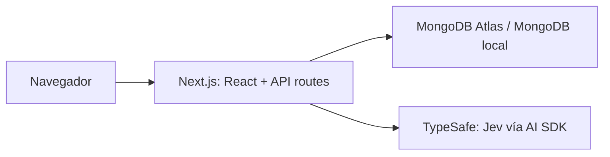

# Arquitectura inicial

Un monorepo npm con una sola aplicación en `apps/web` permite compartir tipos y desplegar frontend y API juntos. No se necesita un orquestador adicional mientras haya una única app.

## Límites actuales

El diagrama muestra las integraciones previstas. La pantalla inicial y `/api/health` no acceden a MongoDB ni a TypeSafe. Las conexiones se inicializan cuando un futuro caso de uso las invoque. No hay contratos de negocio, esquemas ni endpoints de IA.

## Persistencia

`connectDB()` valida `MONGODB_URI` en el servidor, reutiliza la conexión global de Mongoose y comparte la promesa entre llamadas concurrentes. Libera la promesa al finalizar, incluso si falla, para permitir nuevos intentos. Cada instancia de servidor tiene su propio pool (máximo cinco conexiones); no existe un pool global entre funciones de Vercel.

Compose usa un volumen persistente y solo expone MongoDB en loopback. No configura replica set; si un caso de uso requiere transacciones, deberá incorporarse esa configuración. Atlas se configura externamente.

## IA

`getDecisionModel()` crea una instancia del proveedor oficial TypeSafe con la key del servidor y el identificador de Jev. No realiza inferencia. Las futuras llamadas usarán la API experimental de decisiones del AI SDK; las preguntas y los criterios dependen del dominio aún pendiente.

## Referencias

- [Next.js App Router](https://nextjs.org/docs/app/getting-started/installation)
- [Mongoose con Next.js](https://mongoosejs.com/docs/nextjs.html)
- [TypeSafe en AI SDK](https://ai-sdk.dev/providers/ai-sdk-providers/typesafe-ai)
